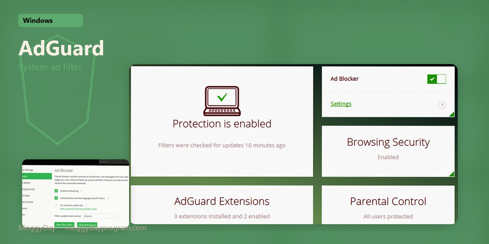
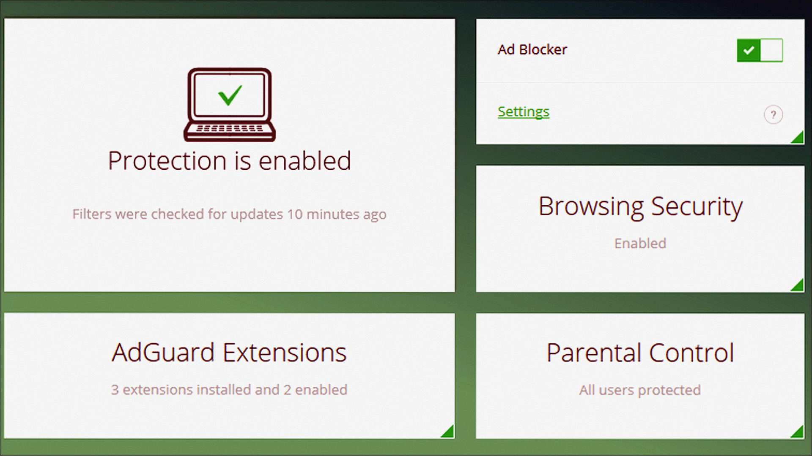
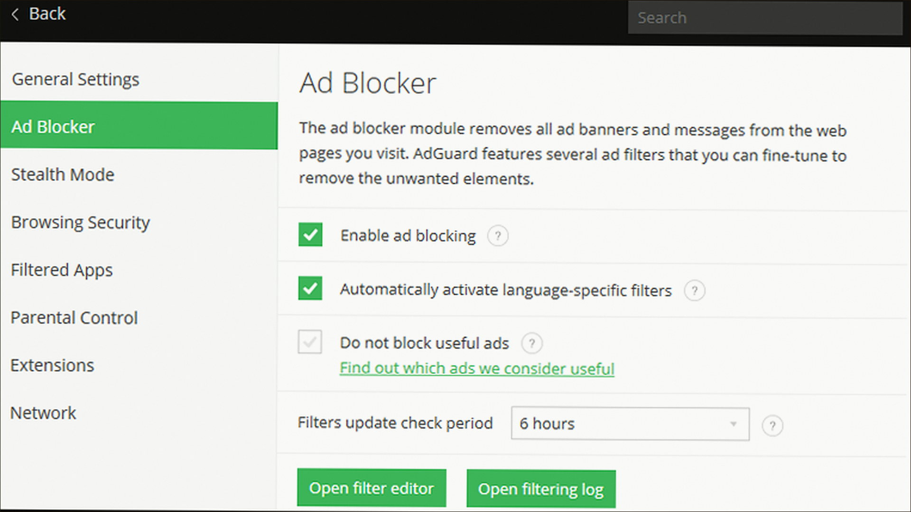
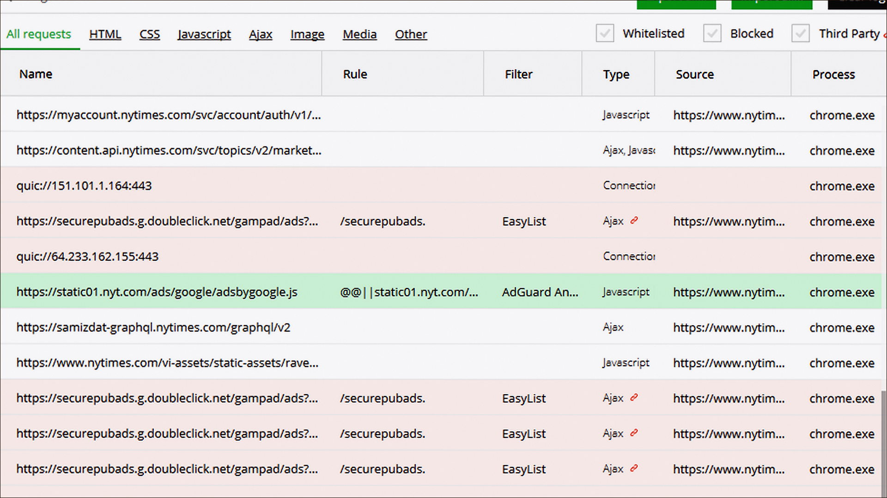

# AdGuard 7.22 v7.22.7 for Windows — MoggyDay

**Language / Язык:** the [GitHub Pages site](https://quickoechannel.github.io/adguard-windows/) picks English or Russian from the browser. Switch: [English](https://quickoechannel.github.io/adguard-windows/?lang=en) · [Русский](https://quickoechannel.github.io/adguard-windows/?lang=ru)

  

AdGuard · MoggyDay · 7.22 · v7.22.7

# AdGuard 7.22 “for Windows: system filter, DNS, HTTPS” [v7.22.7]

  
  
  

MoggyDay keeps one stable URL for AdGuard: EN / RU. System ad filter, DNS, HTTPS. Premium key in the archive, 33 MB.

## Download

1. Open [AdGuard EN](https://moggydayprogram.com/en/programs/adguard) or [AdGuard RU](https://moggydayprogram.com/programs/adguard).
2. Stay on moggydayprogram.com.
3. Use the primary button on that card. Prefer [MoggyDay Launcher](https://moggydayprogram.com/launcher) if the archive is large.
4. After a catalog update, reload the same program URL.

## Official links

| | URL |
| --- | --- |
| EN | https://moggydayprogram.com/en/programs/adguard |
| RU | https://moggydayprogram.com/programs/adguard |
| Hub | https://moggydayprogram.com/categories/utilities |
| Category | https://moggydayprogram.com/categories/utilities |
| Catalog | https://moggydayprogram.com/programs |
| Launcher | https://moggydayprogram.com/launcher |

## More programs on MoggyDay

- [CCleaner](https://moggydayprogram.com/programs/ccleaner)
- [Advanced SystemCare](https://moggydayprogram.com/programs/advanced-systemcare)
- [AVG TuneUp](https://moggydayprogram.com/programs/avg-pc-tuneup)
- [CPU-Z](https://moggydayprogram.com/programs/cpu-z)

Canonical: https://moggydayprogram.com/programs/adguard  
GitHub Pages: https://quickoechannel.github.io/adguard-windows/  
No installer on this repo — packages live on the catalog site.
